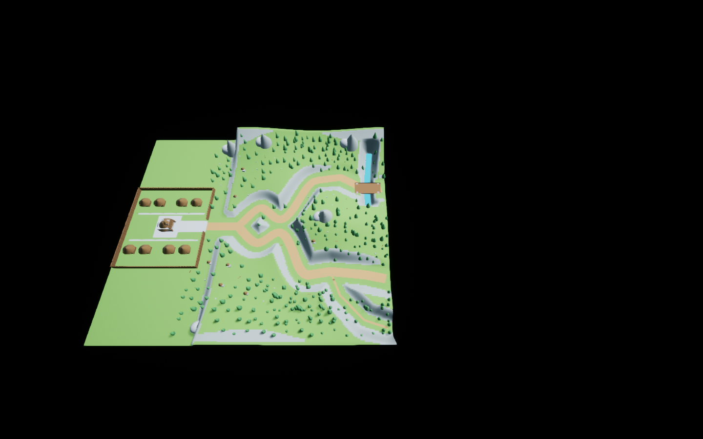

# CrownGuard — Designing a Forest Defense Mission

**Level Design · Technical Game Design · QA**  
A solo-directed, AI-assisted Unreal Engine 5 project combining tower defense planning with a playable third-person archer.

> Work in progress. This portfolio documents decisions, iteration and evidence—not a finished commercial game. Prepared on 22 November 2026 from retained project records and playtest feedback.

*Historical November 1 blockout, not the latest map. Its shared defense position became an important balance experiment. Placeholder geometry is intentional.*

## Start here

| What to explore | Evidence of my work |
|---|---|
| [From concept to playable mission](journey/PROJECT_JOURNEY.md) | Scope decisions, early prototypes, map iteration and remaining work |
| [Designing meaningful defense choices](case-studies/01-DEFENSE-STRATEGY.md) | Playtest observations → layout and economy changes → contrasting strategies |
| [Making terrain and placement readable](case-studies/02-ROADS-AND-PLACEMENT.md) | Reproduction scenarios, visual defects and verification boundaries |
| [Building a faster balance workflow](case-studies/03-BALANCE-WORKFLOW.md) | In-session controls, repeatable presets and attempt reports |
| [QA approach and sample regression plan](qa/QA-APPROACH.md) | Separating implementation, builds, visual checks and gameplay validation |

## My contribution

I define the game direction, write requirements, choose and revise balance rules, evaluate level layouts, run manual playtests and report problems. I use those results to decide what to change next.

C++ implementation, tools and technical documentation have been developed with AI assistance through ChatGPT/Codex. This portfolio is also AI-assisted and compiled from project evidence. It does not present all implementation code as hand-written by me. See [contribution and attribution](CONTRIBUTIONS.md).

## Design goal

Create a mission in which tower placement matters and the hero can respond to trouble across lanes. The player should make useful decisions before and during a wave, rather than simply wait for towers to finish the level.

The project evolved from a browser prototype into a UE5 forest mission with two main approaches, a conditional side route, a fortified village, destructible defenses, progression and a balance laboratory. The latest documented mission has five waves. Earlier case studies deliberately retain their historical three-wave context.

## How I work

**Observe → form a hypothesis → change a bounded set of rules → compare playtests → keep or revise the result.**

An example: a mixed defense at the lane junction cleared a historical version without hero support. After defenses became attackable, the same concentrated strategy failed, while a split defense supported by the hero succeeded. That contrast was more useful than a single win/loss result.

## Current boundaries

- First-map balance and presentation are still being refined; final art integration is pending.
- Latest tool features have implementation records, but a build is not proof of a successful gameplay test.
- Testing-time improvements are described as workflow changes. No measured percentage or hours-saved claim is made.
- No public playable download is included yet. A separate Windows feedback package has been prepared; packaging validation is distinct from playtesting.
- This repository is a curated portfolio. It does not distribute the full Unreal project, private saves, raw conversations or third-party assets.

[Evidence and media provenance](EVIDENCE.md) · [Decision log](journey/DECISION-LOG.md) · [Next evidence to collect](NEXT-EVIDENCE.md)
