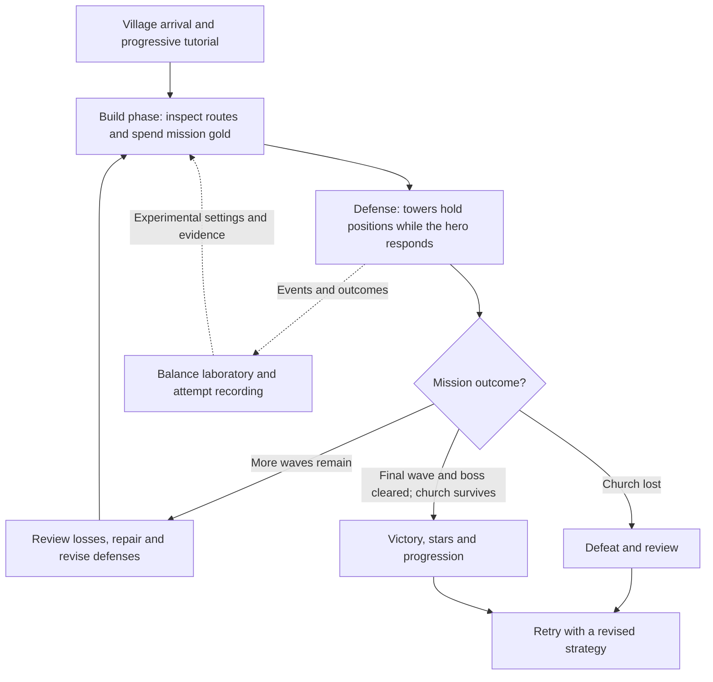

# How CrownGuard's systems work together

**Documentation snapshot: 23 November 2026.** This overview summarizes retained implementation records for the forest mission. It is not a new engine verification or a frozen balance specification. Laboratory overrides, equipment and progression can change actual values in a run.

## The player experience

The player prepares defenses, fights as a third-person archer, responds to pressure across approaches and uses the interval between waves to reconsider the plan. The forest mission has five waves. The village church is the final objective; the gate and cart create intermediate consequences rather than three interchangeable health bars.

## 1. Routes, objectives and escalation

Two main approaches converge toward the fortified village. A conditional side route adds pressure after the cart is destroyed. The layout makes concentration of tower coverage attractive, but concentrates exposure too: enemies can attack defenses.

| Object | Consequence | Decision it creates |
|---|---|---|
| Cart | Destruction enables configured side-route reinforcements in subsequent waves; it does not expand the current wave or create a sixth wave | Protect it or accept additional pressure |
| Gate | Destruction opens the approach and applies a non-stacking 15% speed increase to living and future enemies | Keep an outer defensive layer or prepare to recover inside |
| Church | Destruction ends the mission in defeat | Respond to the final threat before it is too late |

For a completed mission with the church intact, the documented rating is three stars when both gate and cart survive, two when only the cart is lost, and one when the gate is lost. Damage without destruction does not reduce the rating. This replaces the early prototype's escape-count defeat rule.

The five-wave progression introduces armored reinforcements from wave three. Their trigger uses the proportion of main enemies spawned, not killed, and gives a warning before deployment. The boss follows the other enemies of wave five. Forecast information at entrances helps the player prepare rather than discover every threat too late.

**Design intent:** create escalating consequences while preserving opportunities to recover. **Still to validate externally:** whether new players understand these consequences before losing an objective.

## 2. Defenses and spatial choices

| Defense | Documented role | How it relates to other systems |
|---|---|---|
| Archer tower | Long-range, single-target damage | Covers approaches and finishes individual threats |
| Stone tower | Slower, heavier area damage | Benefits from enemies gathering near a frontline; impact timing matters |
| Lightning tower | Faster, lower-damage chain attacks | Benefits from nearby targets while retaining a distinct attack rhythm |
| Barricade | Durable frontline with no attack | Buys firing time for damage towers; placement and bypass space matter |
| Slowing tower | Implemented aura, unavailable for construction on the first map | Deferred because its first-map value was unclear beside barricades |

The latest combat update makes attacking towers select the nearest eligible enemy by horizontal distance before each shot. Area damage and lightning chains remain separate effects; nearest-target selection does not turn them into single-target towers.

Construction uses a preview and footprint validation, with rotation for positioning. Later rules permit construction on roads; older case studies that describe a road-overlap prohibition are historical. Defenses have health and can be destroyed. Mission gold, the construction limit and space constrain the build together.

**Design intent:** let the player combine a frontline and damage roles instead of solving every wave with the same tower. A role description is a hypothesis about usefulness, not proof that every defense is equally valuable.

## 3. Hero and enemy interaction

The third-person hero uses a bow and can move between threatened positions. Enemy types include wolves, melee warriors, ranged throwers, armored enemies and the boss. Ranged enemies stop to attack, creating a different threat from enemies that must reach a frontline.

Hero aggro takes priority when its conditions are met; defenses and objectives remain relevant when the hero is not the active target. The latest ordinary-enemy pursuit rules limit chasing without successful damage, then temporarily prevent immediate reacquisition. The boss is excluded from that specific update. This addresses indefinite circular kiting while preserving deliberate distraction.

Blocking, local avoidance and route recovery connect combat to the level layout. An enemy leaving its route to pursue the hero must return and resume the mission rather than teleport or remain idle. Crowd recovery remains a regression concern, especially at merges and barricades.

**Design intent:** the hero should influence outcomes without becoming an unlimited substitute for planning. Earlier owner tests found switching lanes enjoyable; external tests must establish how understandable and demanding that behavior is for a new player.

## 4. Mission economy versus persistent progression

| Layer | Purpose | Persistence boundary |
|---|---|---|
| Mission gold | Construction, supported field upgrades and other configured defense costs | Part of the current attempt |
| Field tower upgrades | Improve a placed defense during the mission | Do not carry the placed tower's upgrade level into the next map |
| Hero and tower tokens | Purchase persistent passive ranks; resets return spent points for redistribution | Stored with the profile |
| Equipment and inventory | Change the hero's setup; unequipped items return to the bag | Stored with the profile |
| Equipment currency | Separate progression resource from construction gold | Profile economy; do not imply an implemented shop |
| Salvage ingots | Clear eligible unwanted items and retain a future resource | Stored with the profile; spending ingots is not implemented yet |

The November 21 mission document records 320 starting gold and rewards between waves. These are documented baseline values, not a promise that every laboratory run uses them. The portfolio deliberately does not reuse early kill-gold or XP formulas as the current specification.

Barricades have their own persistent defensive passive branches as well as temporary field upgrades. Repair restores health; increasing maximum health through an upgrade is a different operation. Tutorial restrictions and phase restrictions can also affect which action is available.

**Design intent:** separate decisions within a mission from longer-term progression. **Comparison requirement:** record profile, equipment, upgrades and overrides when comparing strategies; a stronger profile can disguise a weaker defensive layout.

## 5. Loot, equipment and inventory cleanup

The documented loot system ties item level to map level. Its five rarity categories are Common, Rare, Mythic, Legendary and Unique. Unique equipment belongs to boss rewards rather than the ordinary drop pool. The forest boss's Phoenix Bow changes the hero's shot to three arrows.

The equipment layout includes a bow, chest piece, hood, gloves, boots and two rings. Inventory manages individual item instances, so removing or salvaging one copy must not affect every item of the same type.

Salvage currently converts eligible bag items into ingots after confirmation. Equipped items must first be removed; Unique items and the Phoenix Bow are protected. Bulk salvage and ingot-funded upgrades are not currently included. The ordinary bow's historical loot implementation also recorded no extra rarity-based damage bonus; do not infer a complete equipment balance from the rarity labels alone.

**Design intent:** offer progression and meaningful equipment choices without allowing inventory clutter to become a permanent obstacle. Drop-rate calibration and equipment usefulness still need controlled player evidence.

## 6. Onboarding, HUD and session flow

Village arrival, the priest encounter and the training dummy introduce the mission through short steps. Teaching is distributed across wave intervals rather than presented as one long initial explanation. The journal preserves unlocked guidance; returning players can repeat or skip completed tutorial material.

Repair is introduced after the first wave and upgrades later. A subsequent November 22 change permits demolition during the first build phase: the older tutorial note that also delayed demolition is superseded on that point.

HUD, route forecasts, threat warnings and the result screen connect actions to consequences. Inventory and progression menus are accessible during a session; pause navigation must return to the same attempt. Settings include key bindings and HUD options, and the project supports English and Russian. Control labels should therefore follow active bindings rather than rely on a screenshot's historical keys.

**Design intent:** show the information needed for the next decision, then provide detail on demand. **Verification boundary:** a compiled interface does not establish readability at every resolution or successful navigation in every menu sequence.

## 7. The balance and QA loop

The laboratory groups supported settings into Hero, Towers, Waves and Resources. Named variants and explicit apply/retry behavior support repeatable experiments. Test progression is isolated from the normal profile.

Attempt recording captures setup context and events, including enemy origin routes after a merge, tower losses and objective damage. HTML is intended for reading; JSON supports analysis. Partial recordings are labeled and events are not a full replay.

Together these tools answer a more useful question than “Did I win?”: **with which setup, where did the defense fail, and what changed between attempts?** They reduce manual setup and reconstruction steps, but no measured time-saving percentage is claimed. See the [workflow case study](case-studies/03-BALANCE-WORKFLOW.md).

## Readiness and next evidence

This overview completes the documentation scope of roadmap Stage 2; it does not certify all systems for release. Stage 3 is external playtesting and prioritized fixes. Useful questions include:

- Can a new player explain why the cart, gate and church matter without coaching?
- Does the tutorial teach enough without interrupting preparation?
- Do different tower combinations produce understandable tradeoffs?
- Can players recover from losses without relying on indefinite hero tanking or kiting?
- Do recorded results agree with the observed attempt and preserve the correct setup?

No game code, assets or balance values were changed for this document. No new Play session or automated suite was run.

## Source notes

This is an English synthesis of retained project records, not a new design proposal. Refer to the [evidence register](EVIDENCE.md) for limitations. Main sources: E06, E08–E15. Earlier loot/progression records are used only for the described systems; newer five-wave, objective and combat records take precedence over their historical wave counts, targeting and tutorial restrictions.
