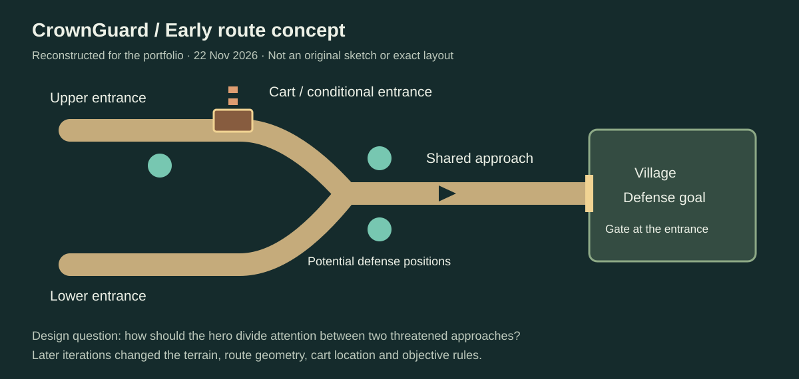
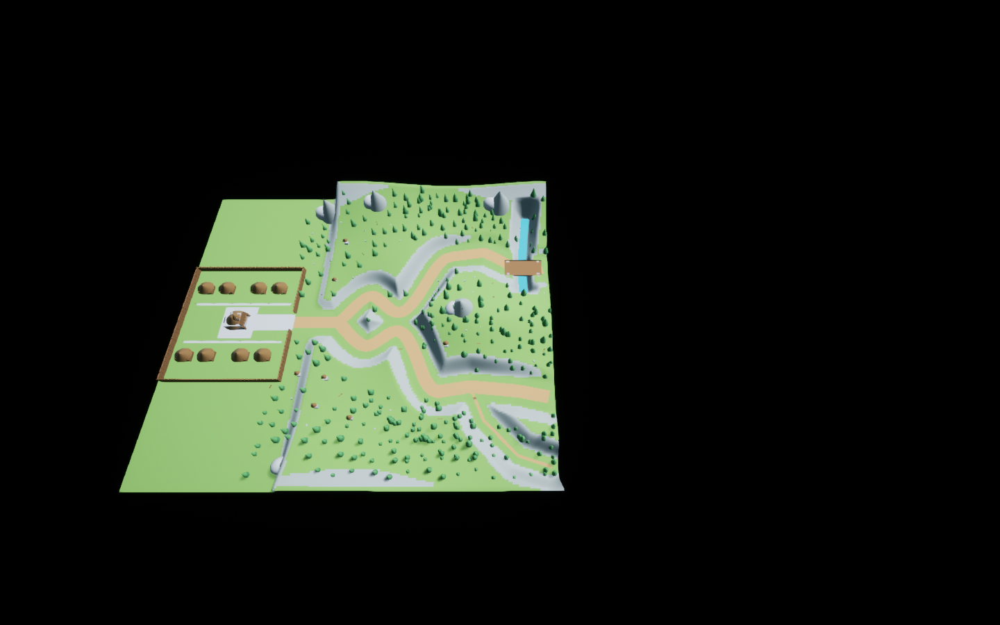

# From first concept to a testable mission

This is a retrospective assembled from retained files and the designer's development discussion. It is not a reconstructed Git commit history. Dates are included only where a dated record supports them; undated steps describe sequence rather than exact days.

## 1. Concept: defend a settlement

The early direction combined an approaching enemy force, defenses and a settlement to protect. A preserved browser prototype explored village resources, workers, a hero and waves. Its broader economy should not be confused with the later Unreal implementation.

The earliest hand-drawn cart-route sketch was referenced during development, but the original file is not available in this portfolio. The diagram below is a new explanatory reconstruction of the agreed route concept—not an original sketch or an exact map.

**Scope decision:** for the Unreal prototype, establish fixed enemy routes, construction areas and alternating build/defense phases before expanding the mechanics. Dungeon Defenders and Dungeon Defenders II were references for the relationship between active hero combat and defensive planning, not sources of copied map assets.

## 2. Early Unreal blockout: prove the loop

The retained Stage 2 description records a simple forest made from engine primitives, a spline route, a build zone and two small test waves. The purpose was to make placement, range and movement editable and observable.

The next stages introduced two roads, a third-person hero and distinct enemy types. A dated October 23 snapshot records enemy blocking, hero pursuit and return to a route, mixed groups, an aura and a construction preview. Its numbers and historical test summaries belong to that snapshot only.

**Lesson:** readable routes and placement feedback matter before visual polish. A prototype can answer gameplay questions without finished models.

## 3. Scale exposed movement and readability problems

Larger maps and denser waves revealed crowd congestion, unnaturally regular formations, long travel time and awkward hero pursuit. Terrain changes also exposed road coverage and tower-placement problems.

Several fixes required follow-up reports. The historical record does not support a story in which every first fix worked. Road surface, enemy steering and visual rotation needed separate diagnoses.

**Decision:** shorten approaches, reconsider spawn positions and verify at hero eye level as well as from above. More terrain and more enemies did not automatically create more interesting play.

## 4. November 1: make strategy the experiment

The first documented gameplay package responded to a playtest dominated by four archer towers. It expanded building options and brought the routes closer together to support a shared defensive position.

Later user reports showed both sides of that choice: a concentrated mixed defense could become too self-sufficient, while attackable towers created risks that rewarded a different layout and active hero support. [Read the strategy case study](../case-studies/01-DEFENSE-STRATEGY.md).

## 5. November 20–22: improve the iteration process

The balance laboratory exposed hero, tower, wave and resource settings in one interface. Named variants and repeat flows reduced the need to return to project settings for supported tuning tasks.

The mission then moved to five waves with clearer tower roles and later armored reinforcements. An attempt recorder was added to capture strategy context, route origins, events and outcomes in HTML and JSON.

**Process lesson:** balance feedback needs context. Equipment, persistent upgrades, laboratory overrides and route-specific leaks can change what a win means.

## 6. Current stage

The first mission is playable and has undergone repeated owner playtests. It remains in development. The next useful proof is a set of comparable recorded runs and an English gameplay capture, not a claim that the mission is finished.

Sources: E01–E09 in the [evidence register](../EVIDENCE.md). The dates describe documentation milestones, not a complete implementation timeline.
